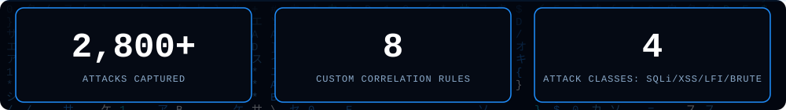

 
 
 

 

## `> cat about_me.md`

I'm **Adarsh AS**, a **Junior Security Analyst** from Thiruvananthapuram, India, focused on **VAPT** and **threat detection**.
I combine **offensive testing** with **defensive monitoring**.
I learn how vulnerabilities are exploited, then build the detections that catch them, which makes my findings clear and my remediation advice practical.

- 🔴 **Red side:** web & network penetration testing, OWASP Top 10, recon & enumeration, vulnerability validation, mobile app testing
- 🟢 **Blue side:** SIEM monitoring, log analysis, correlation rules & alert tuning, IoC analysis, incident response
- 🎓 **Working on:** Offenso Certified Security Professional (**OCSP**), Offenso Hacker Academy
- 🧪 **Practising on:** TryHackMe, LetsDefend, and my own home labs

## `> ./stats --lab`

## `> ls ~/arsenal`

## `> cat ~/projects/*`

### 🛡️ Web Application Attack Simulation & Detection Lab (Splunk Enterprise) · Sep 2026
- Simulated **SQL injection, XSS, LFI, brute-force** and blended attacks against a deliberately vulnerable web app and an Active Directory environment.
- Captured and analysed **2,800+ attacks** in a custom Splunk dashboard, found the top attacking IPs and enriched them with threat-intel reputation data.
- Wrote and tuned **8 custom correlation rules** mapping each attack class to its log signature, cutting false positives.

### 🏢 Active Directory Security Lab (Windows Server & Windows 10)
- Built a Windows Server **Active Directory** domain with a Windows 10 Pro client to mimic an enterprise target.
- Configured users, security groups, OUs and **GPOs** for endpoint security baselines and access control, as groundwork for AD attack-surface and misconfiguration assessment.

### 🌋 Landslide Detection & Early Warning System · Jun 2025 – Jan 2026
- Led a team integrating **4 environmental sensors** with **Arduino/ESP32** using hardware interrupts for real-time data.
- Streamed data over **Wi-Fi + GSM** to mobile alert apps with **sub-2-second latency**, which built my understanding of IoT/embedded communication paths.
- Designed a fault-tolerant, solar-powered architecture that cut power use by **30%+**.

## `> cat certifications.txt`

| | |
|---|---|
| 🏅 **OCSP** | Offenso Certified Security Professional, Offenso Hacker Academy |

## `> ./contact --secure`

 

`"The quieter you become, the more you are able to hear."`
**Open to Junior Security Analyst · VAPT · SOC roles**

⚠️ All testing is performed ethically, in my own labs or authorised environments only.
